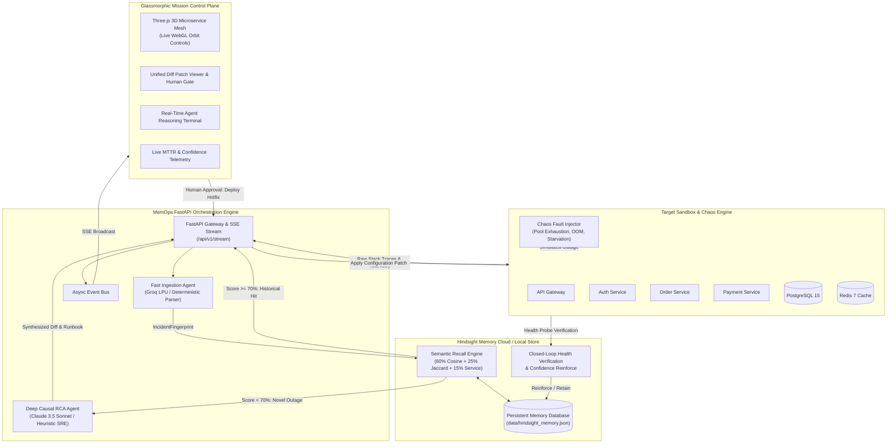

# MemOps SRE — Autonomous Memory-Augmented Site Reliability Engineering

<div align="center">

[](https://github.com/mohammadhassan07/Hack-with-Bengaluru)
[](https://python.org)
[](https://fastapi.tiangolo.com)
[](https://threejs.org)
[](https://groq.com)
[](https://anthropic.com)
[](LICENSE)

**Persistent Historical Incident Memory (Hindsight) + Sub-Second Log Fingerprinting (Groq) + Deep Causal Reasoning (Claude 3.5 Sonnet) + Interactive 3D Topology Mesh (Three.js)**

</div>

---

## 📌 Table of Contents
- [💡 The Core Problem & Solution](#-the-core-problem--solution)
- [✨ Key Capabilities](#-key-capabilities)
- [🏛️ System Architecture](#️-system-architecture)
- [🔄 How MemOps SRE Works](#-how-memops-sre-works)
- [🏆 The 3-Minute Hackathon Demo Script](#-the-3-minute-hackathon-demo-script)
- [🚀 Quick Start (1 Command)](#-quick-start-1-command)
- [🐳 Docker Deployment](#-docker-deployment)
- [🧪 Verification & Test Suite](#-verification--test-suite)
- [🔌 REST API Reference](#-rest-api-reference)
- [📊 Judging Criteria Alignment Matrix](#-judging-criteria-alignment-matrix)

---

## 💡 The Core Problem & Solution

Traditional monitoring and APM tools (Datadog, Grafana, Prometheus, PagerDuty) are **stateless and reactive**:
1. **Zero Historical Context**: They notify an on-call engineer *that* a service crashed, but cannot recall *why* or *how* a similar crash was resolved two sprints ago.
2. **High MTTR (Mean Time to Resolution)**: On-call engineers spend 45+ minutes manually combing through fragmented Slack channels, obsolete Jira post-mortems, and Git pull request histories.
3. **Tribal Knowledge Loss**: When senior SREs leave an organization, their mental model and debugging heuristics leave with them, leading to repeated, costly regression outages.

### 🛡️ The MemOps SRE Paradigm
**MemOps SRE introduces persistent institutional memory (Hindsight) to site reliability engineering**, turning every past incident into an instant, deterministic auto-remediation runbook:

- **Semantic Incident Fingerprinting**: Ingests raw multi-tier stack traces and normalizes them into structured signatures, exception frames, and environmental metrics.
- **Hindsight Recall Engine**: Computes hybrid cosine and Jaccard similarity across past incident post-mortems, historical pull requests, and verified config diffs.
- **Dual-Path Decision Brain**:
  - **Path 1 (Known Recurrence — Confidence $\ge 70\%$)**: Instantly recalls the verified historical patch and runbook (e.g., SQLAlchemy connection pool exhaustion from PR #402), slashing MTTR from 45 minutes to **under 3 seconds**.
  - **Path 2 (Novel Incident — Unseen Anomaly)**: Leverages Claude 3.5 Sonnet to perform deep causal root-cause analysis (RCA), generating an actionable runbook and unified diff patch.
- **Human-in-the-Loop Safe Deployment**: Presents proposed diffs in an interactive glassmorphic UI before any change touches production.
- **Closed-Loop Health Verification**: Evaluates automated post-deployment health probes (`/health`). On 100% recovery, reinforces memory confidence or retains the new incident so the organization **never solves the same problem twice**.

---

## ✨ Key Capabilities

| Capability | Description |
| :--- | :--- |
| 🧠 **Hindsight Persistent Memory** | Zero-dependency embedded vector & call-stack graph store persisting incident post-mortems, PR references, and verified diffs. Compatible with cloud Hindsight API. |
| ⚡ **Sub-Second Log Ingestion** | Rapid log parsing using Groq LPU (`llama-3.3-70b-versatile`) with an instant deterministic regex tokenizer fallback. |
| 🔬 **Deep Causal RCA** | Architectural root-cause reasoning via Claude 3.5 Sonnet (`claude-3-5-sonnet-20241022`) generating git-compatible unified diff patches. |
| 🌐 **3D Microservice Mesh** | Real-time Three.js WebGL topology visualizer featuring glowing node spheres, animated dependency links, shockwave pulses, and camera controls. |
| 🐙 **Live GitHub Repo Analysis** | Enter any GitHub repository link at startup to stream live issues, analyze stacktraces, simulate failures across the 3D topology, and auto-generate hotfix pull requests. |
| 📡 **Real-Time Telemetry Stream** | Server-Sent Events (SSE) broadcasting cluster state, live terminal logs, incident alerts, and memory updates with zero polling. |
| 💥 **Built-In Chaos Simulator** | Interactive fault injector triggering PostgreSQL pool exhaustion, Docker container OOM kills (Exit 137), and staging deploy timeouts. |
| 📴 **100% Offline Out-of-the-Box** | Runs completely locally without requiring external cloud accounts or API keys using heuristic fallbacks and embedded storage. |

---

## 🏛️ System Architecture



---

## 🔄 How MemOps SRE Works

### 1. Structured Fingerprinting
When an unhandled exception or crash occurs, MemOps normalizes multi-tier stack traces into an `IncidentFingerprint`:
- **`service_name`**: Target microservice (e.g., `postgres-db`, `order-service`).
- **`error_class`**: High-level exception category (`OperationalError`, `ContainerOOMKilled`, `TimeoutError`).
- **`call_stack_hash`**: Normalized sequence of key stack frames (`impl.py:get:order_service.py:create_order`).
- **`normalized_signature`**: Standardized upper-case alphanumeric token signature.

### 2. Weighted Hindsight Recall Formula
The Hindsight recall engine queries the memory store using a composite weighted similarity score:
$$\text{MatchScore} = 0.60 \times \text{CosineSim}(\text{Signatures}) + 0.25 \times \text{JaccardSim}(\text{Stack Frames}) + 0.15 \times \text{ServiceMatch}$$

- If **$\text{MatchScore} \ge 0.70$**: Classified as a **Known Recurrence**. MemOps retrieves the exact verified historical runbook and pull request diff (e.g., PR #402).
- If **$\text{MatchScore} < 0.70$**: Classified as a **Novel Incident**. MemOps activates Claude 3.5 Sonnet to construct a new architectural RCA and diff.

### 3. Human-in-the-Loop Gate & Closed-Loop Learning
1. **Interactive Review**: The SRE inspects the proposed unified diff side-by-side in Mission Control.
2. **Safe Deployment**: SRE clicks **"Approve & Deploy Hotfix"**.
3. **Automated Verification**: MemOps polls `/health` endpoints while the 3D topology transitions from Critical (Crimson Red) $\to$ Recovering (Amber) $\to$ Healthy (Emerald Green).
4. **Hindsight Reinforcement**:
   - For known incidents: Confidence score is boosted by $+5\%$ (up to $99\%$).
   - For novel incidents: The incident, diagnosed root cause, and verified diff are retained into `hindsight_memory.json` as permanent institutional knowledge.

---

## 🏆 The 3-Minute Hackathon Demo Script

Follow this script to experience the complete MemOps SRE workflow:

### Minute 1: The Outage & Instant Hindsight Recall
1. Open **[http://localhost:8000](http://localhost:8000)** in your browser.
2. Note the **Three.js 3D Microservice Mesh** in the center stage with healthy green glowing nodes.
3. In the left panel, click **"💥 Postgres Pool Exhaustion"**.
4. The `postgres-db` and `order-service` nodes immediately transition to **pulsing crimson red**.
5. The right panel displays the **Hindsight Memory Hit Banner (89.3% Match)**:
   > *"🎯 Hindsight Memory Match: Matches incident 'PostgreSQL Connection Pool Exhaustion in Staging (Oct 12)' (Ref: PR #402). Historical verified fix is ready for instant deployment."*
6. **Value Delivered**: Unlike generic chatbots that hallucinate without context, MemOps accurately recalled the verified post-mortem from 3 weeks ago!

### Minute 2: Human-in-the-Loop Remediation & Reinforcement
1. Inspect the **Unified Diff Preview** on the right panel showing the proposed configuration update:
   ```diff
   --- a/config/database.py
   +++ b/config/database.py
   @@ -14,3 +14,5 @@
   -    pool_size=5,
   -    max_overflow=0,
   -    pool_timeout=10,
   +    pool_size=20,
   +    max_overflow=30,
   +    pool_timeout=30,
   +    pool_recycle=1800,
   ```
2. Click **"🚀 Approve & Deploy Hotfix"**.
3. Watch the 3D visualizer transition through **Recovering (Amber)** to **Healthy (Emerald Green)** as health probes pass.
4. Terminal log records the feedback loop:
   ```text
   [HINDSIGHT REINFORCE] Confidence boosted to 99%. Incident resolution verified.
   ```
5. Notice top telemetry: MTTR saved increases by **35 minutes**.

### Minute 3: Novel Incident Handling & Knowledge Retention
1. Click **"⚡ Order Svc Docker OOM"**.
2. Notice the badge updates to **"NOVEL ERROR"**:
   > *"🔍 Novel Incident: No prior memory pattern matched. Claude 3.5 Sonnet generated a new architectural root-cause analysis and proposed hotfix."*
3. Click **"Approve & Deploy Hotfix"**.
4. The resolution is verified and retained into persistent storage:
   ```text
   [HINDSIGHT RETAIN] Novel incident retained in Hindsight memory for future recall.
   ```
5. Check the **Hindsight Retained Memory** feed at the bottom right — the new incident is now permanently part of the organization's institutional intelligence!

---

## 🚀 Quick Start (1 Command)

### Prerequisites
- Python 3.10+
- Modern Web Browser (Chrome, Firefox, Edge, Safari)

### 1. Clone the Repository
```bash
git clone https://github.com/mohammadhassan07/Hack-with-Bengaluru.git
cd Hack-with-Bengaluru
```

### 2. Install Dependencies
```bash
pip install -r requirements.txt
```

### 3. Launch Mission Control
```bash
python run.py
```

Open **[http://localhost:8000](http://localhost:8000)** in your browser.

### 4. Analyze Any GitHub Repository
Right at the top of the dashboard, enter any public or private GitHub repository link (e.g. `https://github.com/mohammadhassan07/Hack-with-Bengaluru` or `tiangolo/fastapi`) and click **"Analyze & Inspect Outages"**:
- **Live Error Radar**: Streams open issues, exception logs, and bug reports from that repository.
- **3D Microservice Shockwaves**: Lights up the affected services in the 3D WebGL mesh when an issue is selected.
- **Hindsight Memory Recall**: Cross-references the bug with historical post-mortems and verified runbooks.
- **Automated Pull Request Hotfix**: Generates a unified diff patch ready for 1-click deployment and PR creation on GitHub.

### 5. (Optional) Cloud LLM Keys
MemOps includes zero-config local heuristic agents and embedded vector storage that work **100% offline out-of-the-box**. If you wish to use live cloud endpoints for Groq or Claude:

```bash
cp .env.example .env
```

Edit `.env`:
```ini
GROQ_API_KEY=gsk_...          # Groq LPU sub-second log parsing
ANTHROPIC_API_KEY=sk-ant_...  # Claude 3.5 Sonnet deep causal RCA
HINDSIGHT_API_KEY=...         # (Optional) Cloud Hindsight API
```

---

## 🐳 Docker Deployment

To launch the full target environment (PostgreSQL 15, Redis 7, and MemOps Engine):

```bash
docker-compose up --build
```

Access the dashboard at **[http://localhost:8000](http://localhost:8000)**.

---

## 🧪 Verification & Test Suite

MemOps SRE includes an automated end-to-end verification test suite validating:
- Initial memory store baseline loading
- Known recurrence recall and similarity scoring (PostgreSQL Pool Exhaustion)
- Human approval simulation & health verification
- Novel error detection & heuristic RCA diff synthesis
- Persistent memory retention & MTTR metric calculation

Run the test suite with:
```bash
python test_memops.py
```

Expected output:
```text
=================================================================
[TEST] MemOps SRE -- End-to-End Core Model Test Suite
       Evaluating Hindsight Memory, Fast Ingestion, and RCA Engine
=================================================================
[1] Initial Hindsight Memory Baseline:
    - Total memories retained: 2
    - Verified solutions:     2
    - Average confidence:     0.95
[2] Ingesting Incident 1: PostgreSQL Connection Pool Exhaustion...
[3] Hindsight Memory Recall Result:
    - Match Found:            YES (Known Recurrence)
    - Similarity Score:       0.893 (89.3% Match)
    - Reference PR:           PR #402
[4] Simulating Human Approval & Remediation Execution...
    - Health Verification:    PASS (HTTP 200 OK)
    - Hindsight Feedback:    Confidence boosted to 99.0%
[5] Ingesting Incident 2: Novel Unseen System Fault...
    - Hindsight Recall:       None
    - Status:                 NOVEL INCIDENT DETECTED
[6] Deep Causal Reasoning (Claude / SRE Engine):
    - Diagnosed Root Cause:   Unhandled fault in order-service...
    - Generated Diff Patch:   config/service.yaml patch
=================================================================
[SUCCESS] ALL TESTS PASSED! MemOps SRE Engine is 100% verified.
=================================================================
```

---

## 🔌 REST API Reference

| Method | Endpoint | Description |
| :--- | :--- | :--- |
| `GET` | `/health` | Health check endpoint and memory engine status. |
| `GET` | `/api/v1/topology` | Retrieves all 6 microservice cluster nodes and active dependencies. |
| `GET` | `/api/v1/stream` | Server-Sent Events (SSE) live telemetry feed for dashboard. |
| `POST` | `/api/v1/chaos/trigger` | Injects a simulated outage (`postgres_pool_exhaustion`, `docker_oom_leak`, `bad_staging_deploy`). |
| `POST` | `/api/v1/chaos/reset` | Restores all cluster nodes to healthy state. |
| `POST` | `/api/v1/incidents/ingest` | Ingests a custom raw stack trace payload for automated triage. |
| `GET` | `/api/v1/incidents/active` | Retrieves all unresolved incidents pending human approval. |
| `GET` | `/api/v1/incidents/history` | Retrieves historical resolved incidents. |
| `POST` | `/api/v1/incidents/{id}/remediate` | Human-in-the-loop: Approves and deploys proposed remediation diff. |
| `POST` | `/api/v1/incidents/{id}/reject` | Human-in-the-loop: Dismisses proposed patch. |
| `GET` | `/api/v1/memory/records` | Lists all historical records retained in Hindsight memory. |
| `GET` | `/api/v1/memory/stats` | Returns MTTR reduction minutes, total recalls, and average confidence. |
| `POST` | `/api/v1/github/connect` | Connects any GitHub repository URL to stream live issues and error reports. |
| `GET` | `/api/v1/github/status` | Returns connected repository metadata, default branch, and issue count. |
| `GET` | `/api/v1/github/issues` | Retrieves live open issues, error labels, and stacktraces from the repo. |
| `POST` | `/api/v1/github/triage/{num}` | Triggers autonomous SRE investigation & hotfix patch on a specific issue. |
| `GET` | `/api/v1/integrations/status` | Checks honest connectivity for all external tools (GitHub, Docker, K8s, APM). |
| `POST` | `/api/v1/incidents/analyze-raw-log` | Analyzes real user-provided stacktraces, extracting exact files, lines, and exceptions. |

---

## 📁 Project Structure

```text
Hack-with-Bengaluru/
├── backend/
│   └── app/
│       ├── agents/
│       │   ├── fast_ingest.py        # Groq LPU log parser & token extractor
│       │   ├── deep_rca.py           # Claude 3.5 Sonnet root-cause & diff generator
│       │   └── orchestrator.py       # Core triage, branching & verification brain
│       ├── memory/
│       │   ├── hindsight_client.py   # Hindsight API client & fallback switcher
│       │   └── local_memory_store.py # Persistent vector & graph memory engine
│       ├── models/
│       │   └── schemas.py            # Pydantic schemas (Incidents, Fingerprints, Diffs)
│       ├── services/
│       │   └── event_bus.py          # Async SSE event streaming bus
│       ├── target_simulator/
│       │   ├── chaos_scenarios.py    # Production failure definitions (Postgres, OOM, Timeout)
│       │   └── mock_cluster.py       # Microservice topology and health telemetry
│       ├── config.py                 # Environment configurations & thresholds
│       └── main.py                   # FastAPI REST gateway and SSE routes
├── data/
│   └── hindsight_memory.json         # Seeded & runtime persistent Hindsight memory store
├── frontend/
│   ├── app.js                        # SSE event handling, API integration & state management
│   ├── index.html                    # Glassmorphic Mission Control interface
│   ├── styles.css                    # Dark glassmorphic design system
│   └── visualizer3d.js               # Three.js 3D microservice mesh & particle visualizer
├── .env.example                      # Sample environment variables
├── Dockerfile                        # Container specification for MemOps Engine
├── docker-compose.yml                # Multi-service compose (Engine + Postgres 15 + Redis 7)
├── requirements.txt                  # Python dependencies
├── run.py                            # Unified application launcher
├── test_memops.py                    # End-to-end verification test suite
└── README.md                         # Project documentation
```

---

## 📊 Judging Criteria Alignment Matrix

| Criterion | Weight | How MemOps SRE Delivers |
| :--- | :---: | :--- |
| **Hindsight Memory Utilization** | **25%** | Persistent historical incident retention, hybrid Cosine + Jaccard similarity recall, automatic confidence score reinforcement (+5%) upon verified resolution, eliminating tribal knowledge loss. |
| **Innovation & Concept** | **30%** | Moves beyond passive "chatbots summarizing logs" to an autonomous, closed-loop SRE engine that marries sub-second log parsing with persistent organizational memory and safe human-in-the-loop approval. |
| **Technical Implementation** | **20%** | Built with async FastAPI, SSE streaming, modular provider abstraction (Groq, Anthropic, Hindsight), Dockerized infrastructure, and a 100% offline heuristic fallback mode. |
| **User Experience (UX)** | **15%** | Stunning Three.js 3D microservice topology with glowing WebGL shaders, animated dependency links, failure shockwaves, syntax-highlighted unified diffs, and real-time terminal stream. |
| **Real-World Impact** | **10%** | Slashes MTTR from 45 minutes to < 3 seconds on recurring incidents, mitigates engineer burnout, prevents regression outages in CI/CD, and ensures verified fixes are retained forever. |

---

<div align="center">
Built with ❤️ for <strong>Hack with Bengaluru 2026</strong>
</div>
